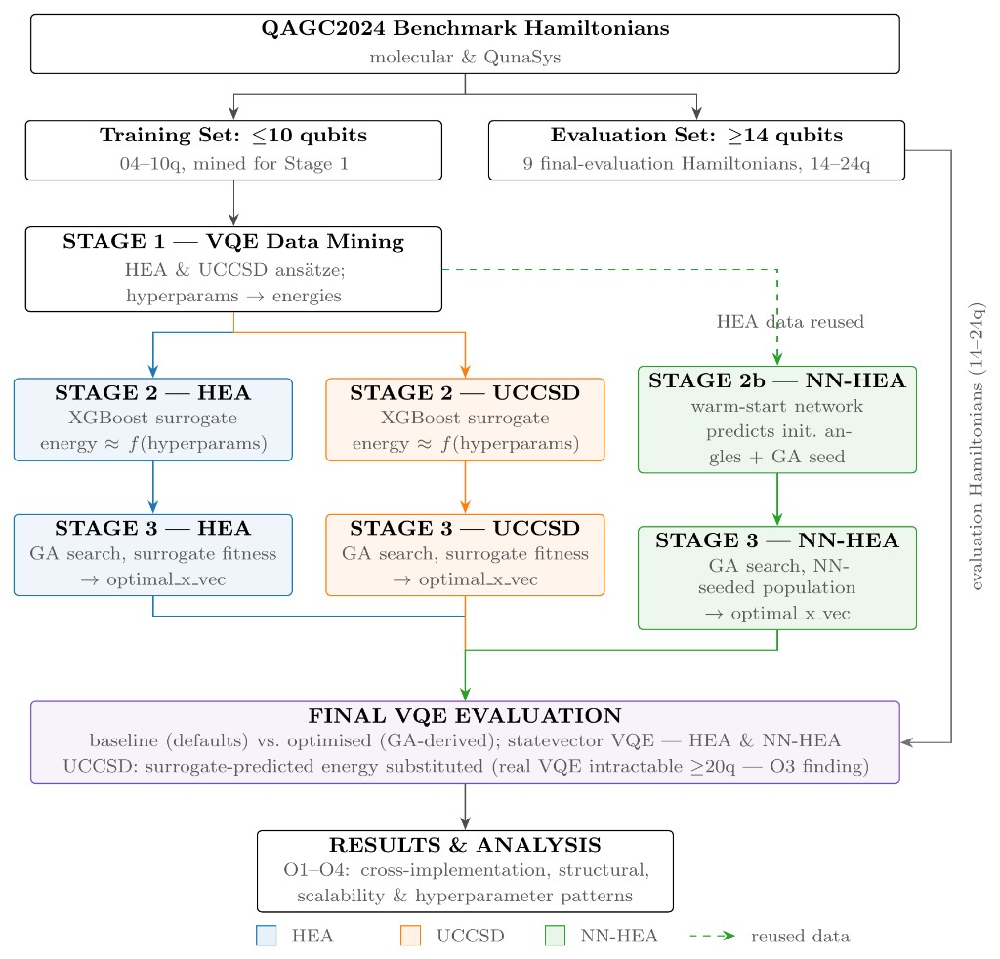
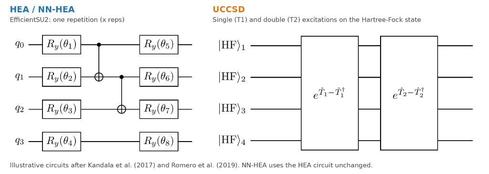
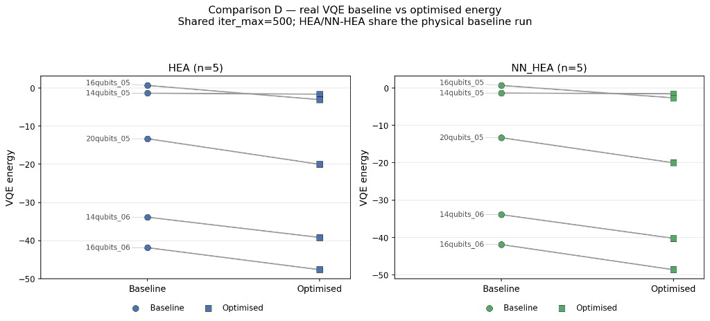
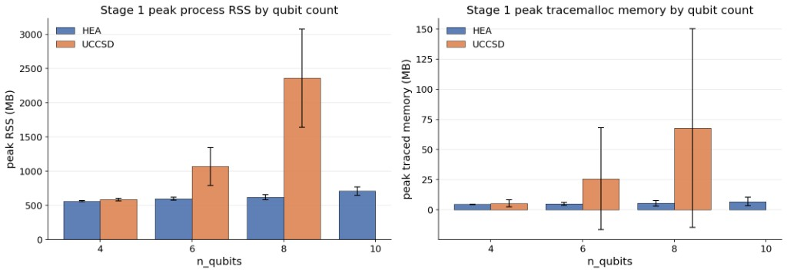

# HEA / NN-HEA / UCCSD: New QE Implementations for AccelerQ

This contribution adds three quantum-eigensolver (QE) implementations to AccelerQ, following the project's TEMPLATE pattern (Phases 1–3 + optional Final VQE). The original ADAPT-QSCI and QCELS use-cases are unchanged.

| Implementation | Ansatz | AccelerQ stages | Final VQE |
|---|---|---|---|
| **HEA** | Qiskit `EfficientSU2` | Stage 1 → 2 → 3 | Yes (baseline + optimised) |
| **NN-HEA** | Same HEA ansatz; one NN-predicted candidate injected into the Stage 3 GA population | Stage 2b → 3 (reuses HEA Stage 1 + HEA XGBoost) | Yes (shares HEA baseline) |
| **UCCSD** | Qiskit UCCSD | Stage 1 → 2 → 3 | No: surrogate-predicted energy only (real VQE is intractable at ≥ 20 qubits, see [Scope and limitations](#scope-and-limitations)) |



*AccelerQ phases for the three implementations. Black: shared pipeline and data. Blue: HEA. Orange: UCCSD. Green: NN-HEA (dashed arrow = HEA Stage 1 data reused). Purple: Final VQE evaluation.*



*Ansatz structure of the three implementations. HEA and NN-HEA share one circuit family (EfficientSU2); UCCSD applies single and double excitation operators to a Hartree–Fock reference.*

## What this adds

AccelerQ already optimises QE hyperparameters with (1) data mining on smaller Hamiltonians, (2) a program-specific ML surrogate, and (3) a genetic algorithm (GA) guided by that surrogate. This work plugs three new black-box QE programs into that same loop.

| Piece | Role | Main files (this folder) |
|---|---|---|
| HEA VQE core | EfficientSU2 ansatz + classical VQE wrapper | `src/kcl_HEA_VQE.py`, `src/kcl_util_HEA.py`, `src/kcl_tests_HEA.py` |
| HEA stages | Mine → train XGBoost → GA deploy | `src/kcl_HEA_stage_{1,2,3}.py` |
| NN-HEA model | Predict HEA `x_vec` (+ angles) from Hamiltonian features | `src/kcl_NN_model.py`, `src/kcl_util_NN_HEA.py`, `src/kcl_tests_NN_HEA.py` |
| NN-HEA stages | Train NN after HEA Stage 2; GA with warm-start | `src/kcl_NN_HEA_stage_2b.py`, `src/kcl_NN_HEA_stage_3.py` |
| UCCSD VQE core | UCCSD ansatz + classical VQE wrapper | `src/kcl_UCCSD_VQE.py`, `src/kcl_util_UCCSD.py`, `src/kcl_test_UCCSD.py` |
| UCCSD stages | Full Stage 1–3 parallel to HEA | `src/kcl_UCCSD_stage_{1,2,3}.py` |
| Ansatz cache | `lru_cache`d parameter-count check used by the Stage 3 semi-dynamic tests (cuts Stage 3 test runs from ~30 min to ~30 s) | `src/kcl_util_ansatz_cache.py` |
| Final VQE | True VQE for HEA / NN-HEA Stage-3 vectors | `src/final_VQE_run.py` |
| Analysis | Objectives 1–4 (energy, structure, resources, SHAP) | `src/kcl_obj{1,2,3,4}_analyse.py` |
| Orchestration | Phase wrappers | `Artifact_Experiments/phase_{1,2,2b,3}.sh`, `run_all_stages.sh`, `run_all_analysis.sh` |

Shared AccelerQ glue included here (extended for profiling / warm-start / analysis): `src/kcl_prepare_data.py`, `src/kcl_train_xgb.py`, `src/kcl_opt_xgb.py`, `src/kcl_util.py`, `src/kcl_util_hamiltonian.py`. Upstream `templates/` are unchanged.

Additions to the shared pipeline (not in the original AccelerQ):

- **Resource profiling** in all three stages: Stage 1 records peak RSS (`psutil`) and `tracemalloc` peak per VQE call; Stage 3 samples memory every GA iteration and records per-checkpoint time; Final VQE records wall-clock time per run.
- **GA stagnation early exit** in Stage 3 (relative change in corpus size below 5 % on two consecutive checks, every 5 iterations); the exit iteration is logged as `convergence_iter`.
- **Train/test traceability** in Stage 2: the held-out 10 % of each mined file is flagged `split = test_extra` in `records_*.csv`, so surrogate error is only ever computed on records the XGBoost model never saw.
- **Timeout vs failure**: Stage 1 samples that exceed their per-sample timeout are stored with `status = timeout` and a penalty energy of 3.0, distinct from `status = failed`.

### Hyperparameter vector (`x_vec`)

All three implementations use a length-14 vector compatible with AccelerQ's Stage 1–3 CSV schema. Indices **0–1** are fixed per run (`n_qubits`, `is_classical`); **6–13** are the procedural solver knobs shared by all three implementations; **2–5** are the structural (ansatz) slots, which differ between HEA / NN-HEA and UCCSD.

The full index table, value ranges, defaults and sampling rules are documented at the top of `kcl_util_HEA.py` and `kcl_util_UCCSD.py` (NN-HEA sanitisation, including the `NN_SEED` sentinel at IND 12, is in `kcl_util_NN_HEA.py`). The global `iter_max` cap is **500**, applied to the default vector, GA sampling and sanitisation, so baseline and GA-optimised runs are compared under the same ceiling.

Validity is enforced twice, as in AccelerQ's TEMPLATE: at generation time (e.g. COBYLA ⇒ `gradient_method = 0`) and again by `sanitize_x_vec_params*()` after every GA combine/mutate step. Stage 3 additionally rejects, via the semi-dynamic test, candidates at ≥ 20 qubits with `reps × n_qubits > 120` or more than 5000 ansatz parameters.

### NN-HEA design note

NN-HEA is **not** a separate ansatz. It reuses:

1. HEA Stage 1 mining (`records_HEA.csv`, `optimal_HEA.csv`, `.npy` tensors),
2. the HEA XGBoost surrogate from Stage 2,
3. a PyTorch network (`data/NN_HEA/nn_hea_model.pt`) trained in Stage 2b.

The network maps the padded Hamiltonian coefficient vector to a warm-start `x_vec` (IND 2–13) plus a zero-padded vector of 336 rotation angles. In Stage 3, **exactly one** member of the initial GA population is the NN prediction (`generate_hyper_params_nn_hea`, `seed == 1`); all other members are random HEA vectors. Every member carries `NN_SEED = -1` at IND 12, which `sanitize_x_vec_params_nn_hea()` preserves through GA clamping and which tells the VQE wrapper to start from the predicted angles. The search space is unchanged from HEA.

Stage 2b trains on the top-5 lowest-energy Stage 1 records per Hamiltonian (a small corpus, 40 records in the architecture ablation), with a single 8-unit hidden layer plus weight decay, 200 epochs, and no held-out split. Treat the network as a warm-start heuristic, not a validated predictor.

HEA and NN-HEA therefore share one physical baseline Final VQE run per Hamiltonian (tagged twice in `Final_VQE.csv`).

## How to install into AccelerQ

From the AccelerQ repository root (same pattern as [GI4Q](../GI4Q/README.md)):

```bash
# Keep upstream copies of any overlapping shared modules you want to diff later
mkdir -p src/_upstream_backup
cp src/kcl_util.py src/kcl_opt_xgb.py src/kcl_train_xgb.py src/kcl_prepare_data.py \
   src/_upstream_backup/ 2>/dev/null || true

# Install implementation + shared modules
cp Ansatz_Extensions/src/*.py src/

# Install phase runners (adds phase_2b / run_all_* alongside upstream scripts)
cp Ansatz_Extensions/Artifact_Experiments/*.sh Artifact_Experiments/
chmod +x Artifact_Experiments/*.sh
```

Create `data/HEA`, `data/NN_HEA`, `data/UCCSD`, and `data/Final_VQE_run` before the first run (the stage scripts also `mkdir -p` as needed).

## How to run

Requires the same AccelerQ environment as the main [README](../README.md) (Python 3.10, Qiskit / OpenFermion stack). The reference runs used Python 3.10.13, Qiskit 0.45.3, qiskit-aer 0.13.3, qiskit-algorithms 0.3.0, qiskit-nature 0.6.0 and XGBoost 3.2.0. NN-HEA Stage 2b additionally needs `torch` (see root `requirements.txt`).

> **Pin `setuptools < 81`.** Installing PyTorch can upgrade `setuptools` to a version that breaks the `stopit` import without raising an error, which silently disables the Stage 1 per-sample timeout.

Edit Hamiltonian prefix lists inside `Artifact_Experiments/phase_1.sh` and `phase_3.sh`, then from the repository root:

```bash
# Full pipeline: Stage 1 → 2 → 2b → 3 → Final VQE
./Artifact_Experiments/run_all_stages.sh

# Or stage-by-stage
./Artifact_Experiments/phase_1.sh    # data mining (HEA and/or UCCSD)
./Artifact_Experiments/phase_2.sh    # XGBoost surrogates
./Artifact_Experiments/phase_2b.sh   # NN-HEA warm-start training
./Artifact_Experiments/phase_3.sh    # GA deploy + Final VQE (HEA / NN-HEA)

# Post-hoc analysis (Objectives 1–4)
./Artifact_Experiments/run_all_analysis.sh
```

Final VQE only (after Stage 3 CSVs exist):

```bash
./Artifact_Experiments/final_VQE_run.sh --mode all --ham-prefix 20qubits_05
./Artifact_Experiments/final_VQE_run.sh --mode baseline --ham-prefix 20qubits_05
./Artifact_Experiments/final_VQE_run.sh --mode optimised --impl HEA --ham-prefix 20qubits_05
```

### Expected compute cost

The surrogate-guided stages are cheap; the real-VQE stages are not. Figures below are from the reference runs on a Slurm cluster (single node, GPU partition, statevector simulation):

| Stage | Cost |
|---|---|
| Stage 1 mining (≤ 10 qubits) | Mean per record: HEA ≈ 15 s, UCCSD ≈ 68 s. Mean peak RSS: HEA ≈ 0.6 GB, UCCSD ≈ 1.3 GB (up to ≈ 3.4 GB). UCCSD mining was only tractable up to 8 qubits, with 80 % of samples succeeding vs 95.5 % for HEA. |
| Stage 2 / 2b | Ran on CPU in the reference runs (the cluster's CUDA version was not supported by the installed PyTorch build), so reported training times are CPU-bound |
| Stage 3 GA | Seconds per Hamiltonian (≈ 13–40 s), independent of qubit count; cost follows GA convergence behaviour |
| Final VQE (HEA / NN-HEA) | Baseline ≈ 0.05 s / iteration at 14 qubits, ≈ 1.4 s / iteration at 20 qubits. GA-optimised runs took 17–504× longer than baseline, up to ≈ 15 h for one 20-qubit run (some of that may be cluster contention). |

## Scope and limitations

- **UCCSD has no real Final VQE.** A single 20-qubit UCCSD VQE iteration took roughly 50 minutes in testing (about 416 hours for a 500-iteration baseline), so every UCCSD result at ≥ 14 qubits is a surrogate-predicted energy.
- **Final VQE covers 5 of the 9 evaluation Hamiltonians** (`14qubits_05`, `14qubits_06`, `16qubits_05`, `16qubits_06`, `20qubits_05`). For `20qubits_00`, `20qubits_01` (Fermi–Hubbard, 54k–64k Pauli terms) and `24qubits_05`, `24qubits_09`, the baseline completed but GA-optimised runs did not fit the compute allocation.
- **Single-seed baselines.** Final VQE runs one baseline per Hamiltonian, whereas the original AccelerQ averages 10 runs. A seed sweep on `16qubits_05` shows the default configuration's energy changes sign with the seed, so per-Hamiltonian `delta_opt` is a point estimate.
- **Simulation only.** All results are classical statevector simulations. They evaluate a hyperparameter-optimisation method and say nothing about quantum advantage or noisy-hardware performance.
- **Sparsity feature.** `sparsity` in `kcl_util_hamiltonian.py` divides a pre-Jordan–Wigner fermionic term count by a post-mapping Pauli-string bound, which can leave [0, 1] (e.g. `4qubits_05`). Treat it as approximate; term count is unaffected.
- **NN-HEA attribution.** Stage 3 does not log which initial-population member the final vector descends from, so the NN's own contribution cannot be separated from the GA's.

## Results at a glance

Evaluated on 9 QAGC2024 Hamiltonians (14–24 qubits), with surrogates trained on Hamiltonians of ≤ 10 qubits. Sample sizes are small (n = 9 for Stage 3, n = 5 per implementation for Final VQE), so these are descriptive.

- **GA beats the surrogate-only pick in all 27 (implementation × Hamiltonian) cases.** Mean surrogate-score improvement `delta_opt`: HEA 0.082 ± 0.015, UCCSD 0.091 ± 0.065, NN-HEA 0.027 ± 0.011.
- **Real VQE:** all 10 default-configuration runs hit the 500-iteration cap without converging; 9 of 10 GA-optimised runs converged earlier (the exception is NN-HEA on `16qubits_05`).
- **NN-HEA does not reliably beat HEA on final accuracy** (mean absolute error to the exact reference on the 4 exactly-solvable Hamiltonians: HEA 0.83, NN-HEA 0.46, each better on 2 of 4).
- **Fewer iterations cost more wall-clock time.** GA selected L-BFGS-B in 9/9 HEA and 9/9 NN-HEA runs, replacing gradient-free COBYLA.
- **Surrogate error tracks Hamiltonian term count, not qubit count** (Pearson r = 0.91 for HEA, 0.98 for UCCSD at training scale). No structural feature predicted Stage 3 gain (|r| < 0.4).
- **UCCSD:** GA selected the Hartree–Fock initial state in 9/9 cases without being told to.



*Real VQE energy, default configuration vs GA-optimised, for the five Hamiltonians with a complete Final VQE run (HEA and NN-HEA share the baseline).*



*Stage 1 mining memory by qubit count (peak process RSS left, peak `tracemalloc` right). UCCSD memory grows with qubit count while HEA stays flat; most of UCCSD's footprint is outside the Python heap, in the simulation backend.*

### Data layout

| Path | Contents |
|---|---|
| `data/HEA/` | Stage 1–3 HEA CSVs, XGBoost model, mined `.npy` |
| `data/NN_HEA/` | `nn_hea_model.pt`, Stage 2b/3 NN-HEA CSVs |
| `data/UCCSD/` | Stage 1–3 UCCSD CSVs, XGBoost model, mined `.npy` |
| `data/Final_VQE_run/` | `Final_VQE.csv` (HEA + NN-HEA) |
| `data/O1`–`O4/` | Analysis tables and figures |

Large mined tensors, trained weights, and analysis dumps are listed in the repo `.gitignore` so they are not included in the pull request by default.

The Hamiltonians are the QAGC2024 benchmark instances already used by AccelerQ. They come from QunaSys's Quantum Algorithm Grand Challenge 2024 data, which is released under QunaSys's own terms rather than the licence of this code; this contribution does not add or redistribute them.

## Relation to AccelerQ TEMPLATE

Each implementation mirrors `templates/kcl_TEMPLATE_stage_{1,2,3}.py`, `kcl_util_TEMPLATE.py`, and `kcl_tests_TEMPLATE.py`:

- **Stage 1** — `miner(...)` + ansatz-specific `wrapper_*` / `compress_*`
- **Stage 2** — `kcl_train_xgb.train(...)` on mined records
- **Stage 3** — `kcl_opt_xgb.opt_hyperparams(...)` + static / semi-dynamic test oracles
- **NN-HEA Stage 2b** — extra learning step on top of the TEMPLATE (warm-start only)

## Attribution

Built on AccelerQ (CC BY 4.0):

> Bensoussan, A., Chachkarova, E., Even-Mendoza, K., Fortz, S. and Lenihan, C. (2025). AccelerQ: Accelerating Quantum Eigensolvers With Machine Learning on Quantum Simulators. *Proc. ACM Program. Lang.* 9(OOPSLA2). https://doi.org/10.1145/3763132

HEA / NN-HEA / UCCSD follow the AccelerQ TEMPLATE API for adding new QE implementations. The Stage 1–3 infrastructure (`kcl_util.py`, `kcl_opt_xgb.py`, `kcl_train_xgb.py`, `kcl_prepare_data.py`) is AccelerQ's; the ansatz implementations, NN-HEA warm-start, profiling instrumentation and analysis scripts are new.

This work was developed for the MSc dissertation *Extending AccelerQ Across Ansatz Classes: Generalisation, Scalability and Hyperparameter Attribution for VQE Optimisation — Implementation on HEA, UCCSD and NN-HEA* (King's College London, 2025/26, supervised by Dr Karine Even-Mendoza). Figures above are reproduced from that dissertation.

**Author:** Miro Nikolic, King's College London; Supervised by Dr Karine Even-Mendoza.
