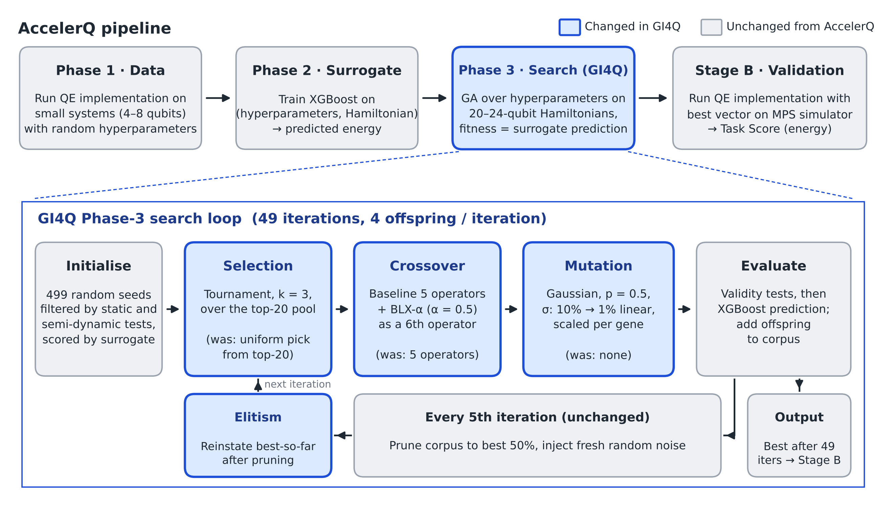

# GI4Q: Evolutionary Search Operators for AccelerQ Phase 3

GI4Q replaces the genetic algorithm (GA) used in AccelerQ's **Phase 3** (model deployment) with a version that has stronger selection, an explicit mutation operator, an extrapolative crossover operator and elitism. Phases 1 and 2 (data generation and the XGBoost surrogate) and the Stage B validation are unchanged.



*Blue: changed in GI4Q. Grey: unchanged from AccelerQ. Vector version: [`figures/gi4q_overview.pdf`](figures/gi4q_overview.pdf); regenerate with `python figures/gi4q_overview.py`.*

## What changes

The search schedule is identical to the baseline: 499 initial seeds, 49 iterations, 4 offspring per iteration, and prune-to-50% plus noise injection every 5th iteration. Any difference in results is therefore due to the operators, not a larger compute budget.

| Mechanism | AccelerQ baseline | GI4Q | Code tag |
|---|---|---|---|
| Selection | Two parents sampled uniformly from the top-20 truncation pool | k-way tournament (k = 3) over the top-20 pool | `[SELECTION]` |
| Crossover | 5 interpolative operators (`random`, `min`, `max`, `cut_half`, `average`) | Same 5, plus BLX-α (α = 0.5) as a 6th operator | `[OPERATOR]` |
| Mutation | None | Gaussian, applied with p = 0.5 per offspring; σ decays linearly from 10% to 1% of each gene's own magnitude over the 49 iterations | `[MUTATION]` |
| Elitism | None | Best-so-far individual tracked, reinstated after each prune, and returned if better than the final corpus | `[ELITISM]` |

Supporting changes needed because mutation and BLX-α can leave the parameter space that the baseline operators stay inside by construction:

- **`[SAFETY]`**: the validity oracles are wrapped so an exception counts as a rejection rather than crashing the run.
- **Bounds clamp**: each offspring is clamped to per-gene `[min, max]` bounds derived empirically from the generator's own output (prevents, e.g., a negative `atol`).
- **Small-Hamiltonian guard**: if a Hamiltonian has fewer than 40 terms, `test_semi_dynamic` is bypassed, since its `num_pickup >= 40` floor cannot be met (affects some 24-qubit molecular systems).

## How to run

`GI4Q/src/kcl_opt_xgb.py` is a drop-in replacement for `src/kcl_opt_xgb.py`: it exposes the same `opt_hyperparams(...)` signature, so the existing Stage 3 drivers (`kcl_adapt_vqe_stage_3.py`, `kcl_QCELS_stage_3.py`) work unchanged.

```bash
cp src/kcl_opt_xgb.py src/kcl_opt_xgb_oopsla2025.py   # keep the baseline
cp GI4Q/src/kcl_opt_xgb.py src/kcl_opt_xgb.py         # switch to GI4Q
```

Then run Phase 3 and Stage B exactly as described in the main [README](../README.md#35-phase-3---model-deployment-section-7-page-15-and-figures-5-6). To revert, copy `src/kcl_opt_xgb_oopsla2025.py` back.

The GA draws all randomness from Python's global `random` module. For reproducible runs, call `random.seed(N)` in the Stage 3 driver before `opt_hyperparams()`.

### Ablation toggles

Each mechanism can be switched off independently at the top of the file, without editing the search loop:

```python
USE_BLX        = True   # BLX-alpha crossover
USE_TOURNAMENT = True   # tournament selection (False = baseline uniform sampling)
USE_ELITISM    = True
USE_MUTATION   = True
```

Hyperparameters of the operators themselves (`TOURNAMENT_K`, `TOURNAMENT_POOL`, `BLX_ALPHA`, `GAUSSIAN_PROB`, `GAUSSIAN_SIGMA_START`, `GAUSSIAN_SIGMA_END`) are defined alongside.

## Results summary

Evaluated on the six open-source molecular Hamiltonians from AccelerQ's Table 5 (`20qubits_05`, `24qubits_05` to `24qubits_09`), for both ADAPT-QSCI and QCELS.

- **Surrogate-space fitness:** GI4Q significantly improves the surrogate's predicted energy over the baseline GA for QCELS (Wilcoxon signed-rank p = 0.0345, Vargha–Delaney Â₁₂ = 0.667, 30 paired seeds). For ADAPT-QSCI the improvement is directional but not significant.
- **Validated Task Score:** the surrogate-space gains do not transfer. GI4Q does not exceed AccelerQ's published Task Scores on any of the six systems, and iteration counts rule out insufficient search effort.
- **Ablation** (on `20qubits_05` and `24qubits_05`): mutation has the largest effect; elitism has a near-zero effect.
- **Surrogate blind spot:** the trained XGBoost surrogates return identical predictions (to six decimal places) for `24qubits_06` to `24qubits_09`, despite distinct Hamiltonian files and distinct feature vectors. This is why the ablation was limited to two systems.

Taken together, these results indicate that surrogate fidelity, rather than search quality, is the binding constraint on Phase 3.

## Negative results

Configurations tried during development and **not** included:

- **Unrestricted tournament** (k = 3 over the full ~500-individual corpus): about 123× weaker selection pressure than the baseline's top-20 truncation (mean parent rank ≈ 123 vs ≈ 9.5); lost 12/12 paired seeds. Restricting the tournament to the top-20 pool fixed this.
- **Fitness sharing:** lost 16/16 paired seeds; niching works against a task where only the single best vector matters.
- **Genotype de-duplication:** marginally harmful; disabled.

## Attribution

`GI4Q/src/kcl_opt_xgb.py` is a modified version of `src/kcl_opt_xgb.py` from AccelerQ (CC BY 4.0). Changes are marked inline with the tags above.

> Bensoussan, A., Chachkarova, E., Even-Mendoza, K., Fortz, S. and Lenihan, C. (2025). AccelerQ: Accelerating Quantum Eigensolvers With Machine Learning on Quantum Simulators. *Proc. ACM Program. Lang.* 9(OOPSLA2). https://doi.org/10.1145/3763132

BLX-α: Eshelman, L. J. and Schaffer, J. D. (1993). Real-Coded Genetic Algorithms and Interval-Schemata. *Foundations of Genetic Algorithms* 2.

**Author:** Aditya Vohra, MSc Data Science, King's College London (2025–26), supervised by Dr Karine Even-Mendoza.
